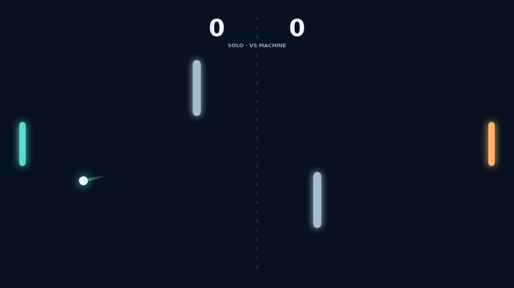

A rally in Carom starts with a clean serve and quickly turns into a duel of position. Guide your paddle to meet the ball where it will be, then use the angle of contact to send it across the field.

Move while you strike and your paddle adds spin. The ball bends in flight, and the paired obstacles give every rally new bank shot lines to read, exploit, or defend.

Points come when the ball slips past the far edge. Each point resets the serve, while the pace rises with every paddle return. Reach eleven and hold a two point lead to close out the match.

